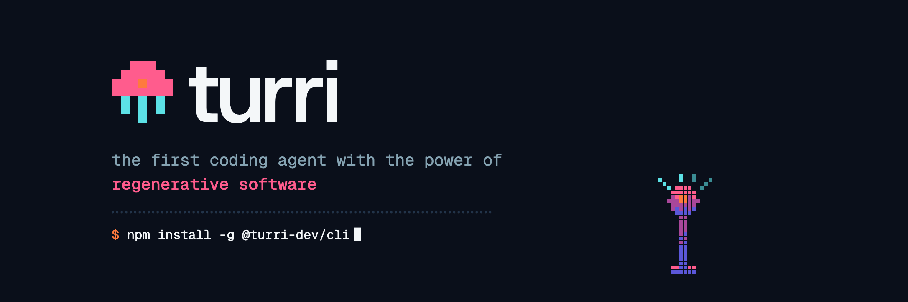

<p align="center"></p>

<p align="center">
  <a href="https://www.npmjs.com/package/@turri-dev/cli"></a>
  <a href="LICENSE"></a>
  <a href="https://nodejs.org/en/download"></a>
  <a href="https://discord.com/invite/REJzFmVQfC"></a>
</p>

**turri** is the first coding agent with the power of [regenerative software](https://chadfowler.com/regenerative-software/). It gives you back control over engineering while the agent handles the coding. Instead of maintaining code, you maintain the system's definition (specs, tests, and ADRs) structured using [\*\*\*plain](https://plainlang.org/). You describe what you want, **turri** captures it as a durable, reviewable system definition, and generates the code from it. As your intent evolves, **turri** regenerates the affected code rather than patching it prompt after prompt. The system definition remains the source of truth, and tests verify that the generated code conforms to it.

Code is disposable, system definition is durable.

**turri** is named after *Turritopsis dohrnii*, the immortal jellyfish that regenerates itself from its young form, again and again - as **turri** regenerates the code from the durable intent - see [the name](#the-name).

**turri** has a desktop app too: [turri desktop](https://github.com/turri-oss/turri-desktop).

## Quick start

**turri** is built on [pi](https://pi.dev/) and runs on macOS, Linux, and WSL (native Windows via Git Bash is best effort). You'll need Git, Bash, and Node.js 22.19+.

### Install

```bash
npm install -g @turri-dev/cli
turri doctor
```

`turri doctor` checks your environment and tells you how to fix any missing dependencies. See the [installation guide](docs/installation.md) for details.

### Configure your models

**turri** uses a capable model to define the system and plan the work, and a smaller, cheaper model to write the code. It supports any model provider available through [pi](https://pi.dev/), and some subscriptions too.

```bash
mkdir my-project && cd my-project
turri init-config
```

Choose your model provider, then sign in with `/login` once **turri** has started.

### Build your first app

```bash
turri
```

Then simply describe what you want:

> Build a small API where users can register and sign in.

**turri** captures your intent in [\*\*\*plain](https://plainlang.org/), generates the code, and validates it against the system definition.

As your requirements evolve, just describe the changes. **turri** updates the system definition and regenerates the affected code.

### Other ways to run turri

Prefer a graphical interface? Try [turri desktop](https://github.com/turri-oss/turri-desktop).

You can also run **turri** [in Docker](docker/README.md), or [from a clone](#from-a-clone) to follow `main` or work on **turri** itself.

For more, see [Using **turri**](docs/using.md) and [Examples](examples/README.md).

### From a clone

To run the local version of **turri** instead of the npm package:

```bash
git clone git@github.com:turri-oss/turri.git && cd turri
npm install
npm link        # puts `turri` on your PATH, pointing at this clone
turri doctor
```

The clone runs its TypeScript sources directly, so there is nothing to build. To pick up new commits, run `git pull` and `npm install`, then start **turri** again - a running one keeps the code it started with. More in the [installation guide](docs/installation.md#from-a-clone).

## Why

Coding agents write in minutes what used to take teams weeks. But while coding got faster, our ability to understand and review code didn't. We increasingly become accountable for software we don't fully understand.

Software built with coding agents grows prompt after prompt, patch upon patch. Decisions and reasoning get lost in chat sessions, misunderstandings accumulate in the code, and each change builds on top of the last. Eventually, neither the developer nor the agent fully understands the system anymore.

Better models and more elaborate agent workflows don't solve the fundamental problem: code remains the source of truth, and humans are expected to understand and maintain something they can no longer meaningfully review.

Regenerative software flips the traditional model of software development. Instead of maintaining code and trying to preserve the reasoning behind it, we maintain the system's definition and regenerate the code from it.

With **turri**, you engineer the system's definition instead of maintaining its implementation. The agent writes the code, but you retain the understanding and control over what gets built.

**The goal isn't to write code faster. It's to understand your software again.**

For the story behind **turri**, read [Why I built turri](https://turri.dev/blog/why-i-built-turri/).

## Code is disposable

### 1. Define

Describe what you want to build or change. **turri** captures your intent as a structured system definition using [\*\*\*plain](https://plainlang.org/), including specifications, architectural decisions, and tests.

### 2. Review

Review the system definition before implementation begins. Make sure it describes what you actually want, without getting lost in implementation details.

### 3. Regenerate

**turri** generates code from the approved definition. When requirements change, it regenerates the affected parts of the implementation rather than accumulating patches on top of existing code.

### 4. Prove

**turri** verifies the generated implementation against independently defined tests. The coding agent cannot change the tests to make its implementation pass. If validation fails, **turri** iterates until the implementation conforms to the definition.

## The name

**turri** is short for [*Turritopsis dohrnii*](https://en.wikipedia.org/wiki/Turritopsis_dohrnii), the immortal jellyfish, which, when injured or old, turns back into its young self and regenerates - the same jellyfish, from the same genes, again and again.

That is what regenerative software asks of software, and what **turri** does:

| *Turritopsis dohrnii* | **turri** |
| --- | --- |
| Its genes are what it is: every generation develops from the same ones. | \*\*\*plain is what the software is: every generation of code is regenerated from it. |
| Injured or old, it does not patch itself: it goes back to the polyp and regenerates the adult. | Code that has drifted is not patched prompt after prompt: it is regenerated from \*\*\*plain, as much of it as has to be. |
| Every cell can become another, and it is still the same jellyfish. | Every line of code can be replaced, and it is still the same software - because what it is never lived in the code. |
| It can do it again and again, for as long as it lives. | The code can be regenerated whenever \*\*\*plain changes or a model gets better, for as long as \*\*\*plain is kept. |

So the tools speak its language: **`regenerate`** regenerates the code from \*\*\*plain as it is now - or the functionalities you name, though nothing changed, or all of it from scratch - **`drift`** says how far the code has moved from it, and **`lineage`** shows every generation of a module and what each was regenerated from.

## Models

`init-config`'s models are only a starting point. **turri** is built on [pi](https://pi.dev), so any model [pi](https://pi.dev) supports works - Anthropic, OpenAI, Google, Amazon Bedrock, OpenRouter, a local one. A model is reached as [pi](https://pi.dev) reaches it - `/login`, in `turri` as in `pi`, the provider's API key in the environment (`ANTHROPIC_API_KEY`, `OPENAI_API_KEY`, `GEMINI_API_KEY`, ...), or a cloud account - and named as [pi](https://pi.dev) names it, `provider/model-id`, with `:high`, `:low` and so on for how hard it thinks. It uses three: the **harness** model you talk to, which writes \*\*\*plain and plans the work - worth a capable one - and the **coding** and **judge** models its agents build and judge with, which can be smaller and cheaper, such as GPT-6 Luna or Gemini 3.1 Flash Lite. `turri --harness-model` and `--coding-model` choose them for a session, and [pi](https://pi.dev)'s `/model` switches the one you talk to as you go; to keep them for the project, set them with `/turri-config harness-model`, `/turri-config coding-model` and so on - each role's too, as `models.<role>` - or write them in its `config.turri.yaml`:

```yaml
harness-model: anthropic/claude-opus-5-5    # the model you talk to: a capable one
coding-model: openai/gpt-6-luna             # writes the code and the tests: a smaller one will do
judge-model: google/gemini-3.1-flash-lite   # judges the conformance runs
```

One left out is the one before it: judge from coding, coding from harness. Every way to set them: [models](docs/config.md#models).

## Use

In the project where your \*\*\*plain lives:

```bash
cd ~/my-project
turri
```

Then say what you want:

> A small API where people can register and sign in, in Python.

In a new project **turri** starts it itself, without asking how: it chooses the stack - the one you name, else a standard library stack this machine can build - writes the module and its unit testing script (and the conformance tests' when you ask for them, or the [test advisor](docs/test-advisor.md) finds a functional spec that needs them), regenerates the smallest thing that runs at once, then the main thing you described, and says what it chose and what it would write next. Every change after is yours to ask for: **turri** writes it as \*\*\*plain and regenerates it. While it works:

- the **panel** above the input shows every build - its stage, what its agents are doing, its model and cost - and the queue behind it;
- ask to try it at any time - "let me try it" - and **`release`** puts what is built so far in `dist/<module>` and **`activate`** starts it, installing what it needs - nothing to approve;
- the **side panel** (`ctrl+h`) takes the screen and opens on **regen** - \*\*\*plain, every item marked planned, working, regenerated, validating, conform or needs you - and `p` turns it to the **pulses** (`/pulses`) - every pulse, running, queued and finished, and what each regenerates; what its agents did is in each pulse's log in `.turri/jobs/`, kept with `--debug` (`debug: true`);
- **`/halt`** halts a pulse, **`/lineage`** shows every generation of a module, and the **`drift`** tool says what is left to regenerate;
- **`/btw <question>`** asks turri something on the side - answered at once, even while a question waits for you (typed as the answer, under "Something else…"), and left out of the conversation;
- **`/turri-config`** changes any setting of the project's `config.turri.yaml` - the models, review, the test advisor, how many pulses at once - and says when it takes effect: now, at your next message, or at the next pulse. No restart: `/turri-config review false`, or `/turri-config` alone to pick from the list;
- **`/sentinel`** says whether the sentinel checks every pulse that finishes: `ask` (you are asked before it first opens), `on` or `off`;
- **`/stack`** chooses the stack to build with, in a project whose backend and frontend each have their own testing scripts in `config.turri.<stack>.yaml` - `/stack backend`, `/stack none` - for the session (`--stack <name>` on the command line). The chat's model builds each part with its own stack by itself, pinned to that module's pulses.

Other things to ask for:

> Add password reset to \*\*\*plain.
>
> Regenerate the whole module, and conform every functionality with conformance tests.
>
> Regenerate changes to \*\*\*plain with a faster model.

The last one holds for the rest of the session; the model can be chosen separately for changes to \*\*\*plain and for functionalities, and a name that fits more than one model is asked about rather than guessed.

Without a conversation, the same work is on the command line:

```bash
turri parse app.plain    # parse ***plain, its syntax and structure - no model, no API key
turri drift app.plain       # what is left to regenerate - starts nothing
turri regenerate app.plain      # regenerate the code from ***plain: planned into jobs, run until it is done
turri regenerate app.plain app:add-task    # regenerate one functional spec again, changed or not
```

More: [using **turri**](docs/using.md); to regenerate \*\*\*plain overnight, see [running unattended](docs/headless.md).

## Documentation

Start at the [documentation index](docs/README.md), or go straight to a page:

| | |
| --- | --- |
| [Installation](docs/installation.md) | doctor, what turri needs of this machine, **turri** and `pi`, environment variables |
| [Examples](examples/README.md) | projects to build with turri step by step: guestbook - a backend and a frontend in minutes - a CLI, and a backend service tested where it matters |
| [Using **turri**](docs/using.md) | the conversation, skills, tools, pulses and regen, choosing models, the command line |
| [The project config](docs/config.md) | `config.turri.yaml` and each stack's `config.turri.<stack>.yaml`: every key, models and their inheritance, conformance, the testing scripts, stacks and choosing one, the old `config.yaml` |
| [Deploy](docs/deploy.md) | trying what is built: the last commit in `dist/<module>`, started on your machine, nothing installed without asking |
| [Running unattended](docs/headless.md) | regenerating \*\*\*plain overnight or in CI: the command, keeping it running, the results, resuming, rebuilding one functionality |
| [Authoring \*\*\*plain](docs/authoring-plain.md) | what \*\*\*plain is made of, the authoring rules, the skills that write and fix it, checking it |
| [Regenerating](docs/regenerating.md) | what each build does and in which order: functionalities, modules, regeneration, changes to \*\*\*plain, conformance and acceptance tests, working notes, what the code is built from |
| [The sandbox](docs/sandbox.md) | what agents can reach, the walls every command passes, time limits, the web tools |
| [Skills and gates](docs/skills-and-gates.md) | the gate syntax, what the harness enforces, judges, rules |
| [The \*\*\*plain parser](docs/parser.md) | the TypeScript port, `turri parse`, fidelity to the reference parser |
| [Theming](docs/theming.md) | the two brand themes |
| [Development](docs/development.md) | tests, layout, known edges |
| [Contributing](CONTRIBUTING.md) | reporting a bug, making a change, the conventions a pull request follows |
| [Security](SECURITY.md) | reporting a vulnerability, privately |

## License

turri is open source, under the [MIT licence](LICENSE).
