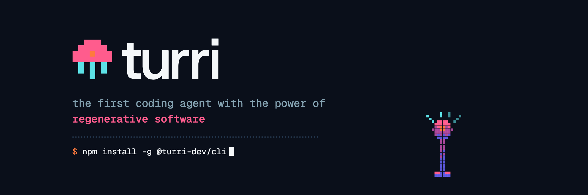

<p align="center"></p>

<p align="center">
  <a href="https://www.npmjs.com/package/@turri-dev/cli"></a>
  <a href="LICENSE"></a>
  <a href="https://nodejs.org/en/download"></a>
  <a href="https://discord.com/invite/REJzFmVQfC"></a>
</p>

**turri** builds regenerative software: what lasts is the system's intent, and the code is derived from it - cheap to throw away and build again. You tell **turri** what the system should do; **turri** writes that down as durable intent, with the tests that say when it is met, and builds the code from it. From then on the durable intent is the source of truth: as it changes, the code is regenerated from it rather than patched in place, and never left to drift from it.

**turri** is named after *Turritopsis dohrnii*, the immortal jellyfish that regenerates itself from its young form, again and again - as **turri** regenerates the code from the durable intent - see [the name](#the-name).

**turri** has a desktop app too: [turri desktop](https://github.com/turri-oss/turri-desktop).

## Quick start

**turri** is built on [pi](https://pi.dev), the coding agent, and runs wherever [pi](https://pi.dev) runs: macOS, Linux, WSL; native Windows best effort, with Git Bash. You need git, bash and [Node](https://nodejs.org/en/download) 22.19 or newer - a Linux distribution's own `nodejs` package is often older. The agents use this machine's toolchains, fenced by a command check and an audit everywhere, and an OS sandbox where the OS has one - Seatbelt on macOS, bubblewrap on Linux (`apt install bubblewrap`) - see [installation](docs/installation.md#installation).

```bash
npm install -g @turri-dev/cli # puts `turri` on your PATH
turri doctor              # checks the machine
```

To follow `main` as it moves, or work on turri itself, run it [from a clone](#from-a-clone) instead.

`doctor` checks for Node 22.19+, bash, the OS sandbox and a model provider for [pi](https://pi.dev); in a project, the toolchains its modules need, what its testing scripts run against this machine, and that each model `config.turri.yaml` names answers with your credentials. It changes nothing without asking: when a check fails - the OS sandbox does not start, say - it says why, and the command for you to run. Run it again whenever something breaks. What each check means: [installation](docs/installation.md).

Then start it in your project, signed in to your model providers:

```bash
cd ~/my-project
turri init-config              # asks which vendor you use: Anthropic, OpenAI, Google, Amazon Bedrock, or other
export ANTHROPIC_API_KEY=...   # the key it names - or skip it, and type /login in turri once it has started
turri
```

`turri init-config` asks which vendor's models you use and writes the project's `config.turri.yaml` with two of theirs - a capable one you talk to, which writes the durable intent and plans the work, and a smaller, cheaper one that writes the code. For Anthropic:

```yaml
harness-model: anthropic/claude-opus-5-5:medium  # you talk to it
coding-model: anthropic/claude-haiku-5-5:low     # it writes the code
```

To skip the question, name the vendor - `anthropic`, `openai`, `google`, `amazon-bedrock` (with `--maker` and `--region`) or `other`:

```bash
turri init-config --vendor anthropic
```

It then tells you which API key to set - or to type `/login` once **turri** is running instead. **turri** loads the `config.turri.yaml` in the folder you start it from. Below the two models, the file sets every other setting to its default - change any of them in the file, or from the chat with `/turri-config`. Any other model works too: [models](#models).

Once `turri` is running, say what you want - `a small API where people can register and sign in` - and **turri** starts the project and regenerates it at once.

No project of your own yet? Build one of [**the examples**](examples/README.md) with turri, step by step.

Rather not install Node and the rest? **turri** also runs in Docker, from one image: [turri in Docker](docker/README.md).

Choosing models: [models](#models); what to do next: [use](#use).

### From a clone

In place of the npm package - for the latest of `main`, or to change turri itself:

```bash
git clone git@github.com:turri-oss/turri.git && cd turri
npm install
npm link        # puts `turri` on your PATH, pointing at this clone
turri doctor
```

The clone runs its TypeScript sources directly, so there is nothing to build. When new commits land:

```bash
git pull
npm install     # picks up any dependency that changed
```

A **turri** already running keeps the code it started with - start it again to run what you pulled. More in [installation](docs/installation.md#from-a-clone).

## Why

Software has always been maintained: written once, then patched for as long as it lives and everything learnt while building it lived only in the code. Coding agents code in minutes what took a team weeks, and they get better at it with every model, so code is now cheap and a disposable asset. It no longer has to be maintained - it can be regenerated. What has to last instead is the intent: what the system should do, and the tests that say whether it does. Get that right and the code is replaceable. Get it wrong and no agent, however capable, can guess what you meant.

Code that is patched, prompt after prompt, drifts: every misunderstanding stays in it, and the next change is made on top. When the software can always be regenerated from durable information instead, that understanding is written down - explicit, reviewable and tested - and it evolves with the software rather than against it.

## How it differs from ye old coding agent

With a coding agent you work on code: you ask for a change, it edits the code, and you review the code it wrote.

With **turri** you work on the durable intent. You say what the software must do, and **turri** updates durable intent and can always regenerate the code from that. You don't review the code or keep it - you review and keep the intent: what the software must do, and what must hold as it changes. The code is a disposable artefact, rebuilt from it whenever it changes.

| | ye old coding agent | **turri** |
| --- | --- | --- |
| **What you maintain** | the code, patched prompt after prompt | the durable intent |
| **What gets built, in what order** | whatever the agent decides, as it goes | the code is built from the durable intent step by step, in a fixed order, so no intent is skipped |
| **Who writes the code** | the agent, and it decides everything else too | the agent - **turri** decides what it builds, the agent only how, line by line |
| **How it works** | improvised, differently every time | a developer workflow baked in - build, unit test, review, conformance test, regression test, commit - the same every time |
| **What counts as done** | the agent says so | every unit of intent is tested and validated by **turri** itself: all its tests pass, or the work goes back |
| **Tests** | written and changed by the agent that writes the code | written from the durable intent, apart from the code; the agent writing the code cannot change them |
| **When it gets stuck** | it keeps going, or quietly works around the problem | it stops and tells you which intent to clarify |

## How it works

**turri** captures the durable intent in [\*\*\*plain](https://plainlang.org/docs/), a language for saying what software should do. \*\*\*plain breaks the intent down into functionalities - small units, each a single thing the software does - and **turri** regenerates the code from them piece by piece.

1. **Define.** You say what the software should do; **turri** writes it down as \*\*\*plain.
2. **Review and refine.** You review \*\*\*plain and change it with **turri** until it says what you mean.
3. **Regenerate.** Agents write the code; **turri** decides what they write and when, step by step, the same way every time.
4. **Validate.** Agents write conformance tests from \*\*\*plain; **turri** runs them, and keeps the code only when it does what \*\*\*plain says.

These are not phases, one after the other: you don't spend hours writing \*\*\*plain and then hours waiting for the code. You go round the loop in small steps, in conversation with **turri** - while you refine the next functionality, the one before it is already being regenerated and validated. A bug is fixed in \*\*\*plain; a new behaviour goes into \*\*\*plain; and the next regeneration carries it. Ask to try it at any time: **turri** puts what is built in `dist` and starts it on your machine - an app, and it tells you where to open your browser.

## The name

**turri** is short for [*Turritopsis dohrnii*](https://en.wikipedia.org/wiki/Turritopsis_dohrnii), the immortal jellyfish, which, when injured or old, turns back into its young self and regenerates - the same jellyfish, from the same genes, again and again.

That is what regenerative software asks of software, and what **turri** does:

| *Turritopsis dohrnii* | **turri** |
| --- | --- |
| Its genes are what it is: every generation develops from the same ones. | \*\*\*plain is what the software is: every generation of code is regenerated from it. |
| Injured or old, it does not patch itself: it goes back to the polyp and regenerates the adult. | Code that has drifted is not patched prompt after prompt: it is regenerated from \*\*\*plain, as much of it as has to be. |
| Every cell can become another, and it is still the same jellyfish. | Every line of code can be replaced, and it is still the same software - because what it is never lived in the code. |
| It can do it again and again, for as long as it lives. | The code can be regenerated whenever \*\*\*plain changes or a model gets better, for as long as \*\*\*plain is kept. |

So the tools speak its language: **`regenerate`** regenerates the code from \*\*\*plain as it is now - or the functionalities you name, though nothing changed, or all of it from scratch - **`drift`** says how far the code has moved from it, and **`lineage`** shows every generation of a module and what each was regenerated from.

## Models

`init-config`'s models are only a starting point. **turri** is built on [pi](https://pi.dev), so any model [pi](https://pi.dev) supports works - Anthropic, OpenAI, Google, Amazon Bedrock, OpenRouter, a local one. A model is reached as [pi](https://pi.dev) reaches it - `/login`, in `turri` as in `pi`, the provider's API key in the environment (`ANTHROPIC_API_KEY`, `OPENAI_API_KEY`, `GEMINI_API_KEY`, ...), or a cloud account - and named as [pi](https://pi.dev) names it, `provider/model-id`, with `:high`, `:low` and so on for how hard it thinks. It uses three: the **harness** model you talk to, which writes \*\*\*plain and plans the work - worth a capable one - and the **coding** and **judge** models its agents build and judge with, which can be smaller and cheaper, such as GPT-6 Luna or Gemini 3.1 Flash Lite. `turri --harness-model` and `--coding-model` choose them for a session, and [pi](https://pi.dev)'s `/model` switches the one you talk to as you go; to keep them for the project, set them with `/turri-config harness-model`, `/turri-config coding-model` and so on - each role's too, as `models.<role>` - or write them in its `config.turri.yaml`:

```yaml
harness-model: anthropic/claude-opus-5-5    # the model you talk to: a capable one
coding-model: openai/gpt-6-luna             # writes the code and the tests: a smaller one will do
judge-model: google/gemini-3.1-flash-lite   # judges the conformance runs
```

One left out is the one before it: judge from coding, coding from harness. Every way to set them: [models](docs/config.md#models).

## Use

In the project where your \*\*\*plain lives:

```bash
cd ~/my-project
turri
```

Then say what you want:

> A small API where people can register and sign in, in Python.

In a new project **turri** starts it itself, without asking how: it chooses the stack - the one you name, else a standard library stack this machine can build - writes the module and its unit testing script (and the conformance tests' when you ask for them), regenerates the smallest thing that runs at once, then the main thing you described, and says what it chose and what it would write next. Every change after is yours to ask for: **turri** writes it as \*\*\*plain and regenerates it. While it works:

- the **panel** above the input shows every build - its stage, what its agents are doing, its model and cost - and the queue behind it;
- ask to try it at any time - "let me try it" - and **`release`** puts what is built so far in `dist/<module>` and **`activate`** starts it, installing what it needs - nothing to approve;
- the **side panel** (`ctrl+h`) takes the screen and opens on **regen** - \*\*\*plain, every item marked planned, working, regenerated, validating, conform or needs you - and `p` turns it to the **pulses** (`/pulses`) - every pulse, running, queued and finished, and what each regenerates; what its agents did is in each pulse's log in `.turri/jobs/`, kept with `--debug` (`debug: true`);
- **`/halt`** halts a pulse, **`/lineage`** shows every generation of a module, and the **`drift`** tool says what is left to regenerate;
- **`/btw <question>`** asks turri something on the side - answered at once, even while a question waits for you (typed as the answer, under "Something else…"), and left out of the conversation;
- **`/turri-config`** changes any setting of the project's `config.turri.yaml` - the models, review, conformance tests, how many pulses at once - and says when it takes effect: now, at your next message, or at the next pulse. No restart: `/turri-config review false`, or `/turri-config` alone to pick from the list;
- **`/stack`** chooses the stack to build with, in a project whose backend and frontend each have their own testing scripts in `config.turri.<stack>.yaml` - `/stack backend`, `/stack none` - for the session (`--stack <name>` on the command line). The chat's model builds each part with its own stack by itself, pinned to that module's pulses.

Other things to ask for:

> Add password reset to \*\*\*plain.
>
> Regenerate the whole module, and conform every functionality with conformance tests.
>
> Regenerate changes to \*\*\*plain with a faster model.

The last one holds for the rest of the session; the model can be chosen separately for changes to \*\*\*plain and for functionalities, and a name that fits more than one model is asked about rather than guessed.

Without a conversation, the same work is on the command line:

```bash
turri validate app.plain    # validate ***plain - no model, no API key
turri drift app.plain       # what is left to regenerate - starts nothing
turri regenerate app.plain      # regenerate the code from ***plain: planned into jobs, run until it is done
turri regenerate app.plain 3    # regenerate functionality 3, changed or not
```

More: [using **turri**](docs/using.md); to regenerate \*\*\*plain overnight, see [running unattended](docs/headless.md).

## Documentation

Start at the [documentation index](docs/README.md), or go straight to a page:

| | |
| --- | --- |
| [Installation](docs/installation.md) | doctor, what turri needs of this machine, **turri** and `pi`, environment variables |
| [Examples](examples/README.md) | projects to build with turri step by step: guestbook - a backend and a frontend in minutes - a CLI, and a backend service with conformance tests |
| [Using **turri**](docs/using.md) | the conversation, skills, tools, pulses and regen, choosing models, the command line |
| [The project config](docs/config.md) | `config.turri.yaml` and each stack's `config.turri.<stack>.yaml`: every key, models and their inheritance, conformance, the testing scripts, stacks and choosing one, the old `config.yaml` |
| [Deploy](docs/deploy.md) | trying what is built: the last commit in `dist/<module>`, started on your machine, nothing installed without asking |
| [Running unattended](docs/headless.md) | regenerating \*\*\*plain overnight or in CI: the command, keeping it running, the results, resuming, rebuilding one functionality |
| [Authoring \*\*\*plain](docs/authoring-plain.md) | what \*\*\*plain is made of, the authoring rules, the skills that write and fix it, checking it |
| [Regenerating](docs/regenerating.md) | what each build does and in which order: functionalities, modules, regeneration, changes to \*\*\*plain, conformance and acceptance tests, working notes, what the code is built from |
| [The sandbox](docs/sandbox.md) | what agents can reach, the walls every command passes, time limits, the web tools |
| [Skills and gates](docs/skills-and-gates.md) | the gate syntax, what the harness enforces, judges, rules |
| [The \*\*\*plain parser](docs/parser.md) | the TypeScript port, `turri validate`, fidelity to the reference parser |
| [Theming](docs/theming.md) | the two brand themes |
| [Development](docs/development.md) | tests, layout, known edges |

## License

turri is open source, under the [MIT licence](LICENSE).
